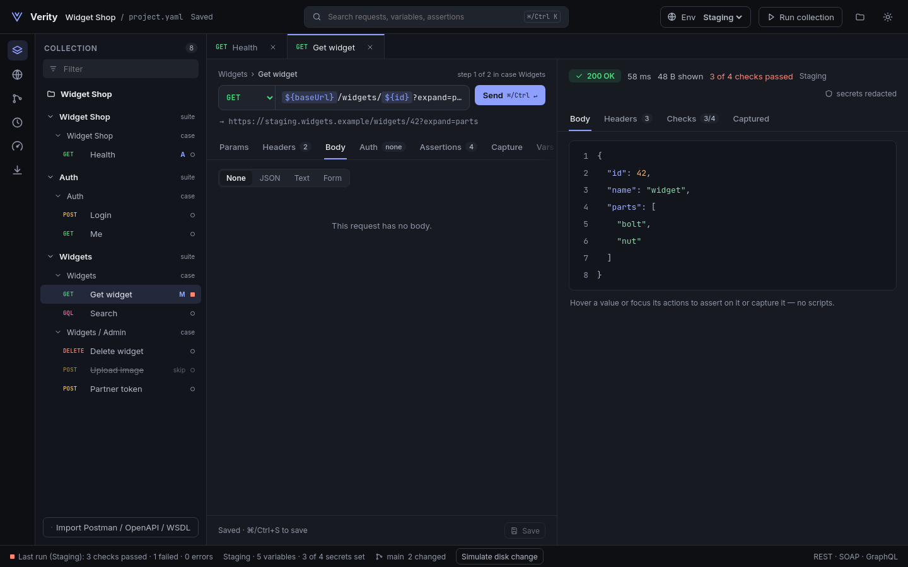
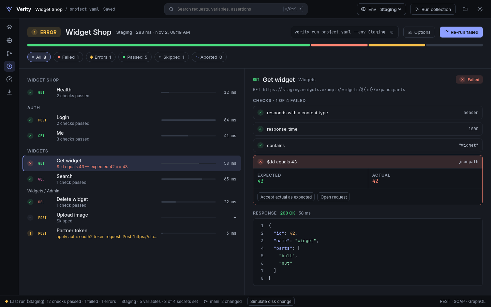

# Verity

Verity is an open-source API contract-testing tool with a CLI and desktop app
for REST, SOAP, GraphQL, and gRPC. Describe requests, assertions, and workflows
in plain YAML, keep them in git, and run the same projects locally or in CI.
Keep secrets out of project files: use `${env:NAME}` or OS keychain references.

**Status: alpha.** Built mainly for Piotr Godlewski's own use and as a portfolio
project. Expect breaking changes during `0.x`. Verity is [MIT licensed](LICENSE).
See the [changelog](CHANGELOG.md) and [roadmap](ROADMAP.md).

## Features

- **Protocols and contracts:** REST (including multipart/file uploads), SOAP,
  GraphQL schema validation and query templates; unary and streaming gRPC
  through the [first-party plugin](plugins/grpc/README.md). Import OpenAPI,
  WSDL, Postman collections, and SoapUI projects, with conversion warnings.
- **Test execution:** status, body, header, JSONPath, XPath, and schema
  assertions; environments, CSV/JSON feeds, captured values, parallel cases,
  retries, timeouts, watch mode, and cancellation with partial reports.
- **Authentication and secrets:** basic, bearer, API key, mTLS, OAuth2, Digest,
  AWS SigV4, and HMAC; environment and OS keychain secrets, shared output
  redaction, secret scanning, and pre-commit hooks.
- **Reports and tools:** console, JSON, JUnit, and HTML reports; mock servers
  from contracts or saved examples; load tests with latency/error thresholds;
  out-of-process plugins for protocols, assertions, auth, reporters, and feeds.
- **Desktop:** request editing and execution, imports, environments, test and
  load results, plus Git diffs, selected-file commits, branches, and stashes.

## Screenshots




Other existing captures: [welcome](docs/screenshots/1-welcome.png),
[assertions](docs/screenshots/3-assertions.png), [light theme](docs/screenshots/4-light.png),
[environments](docs/screenshots/6-environments.png), [import](docs/screenshots/7-import.png),
[load testing](docs/screenshots/8-load-test.png), and
[source control](docs/screenshots/9-source-control.png).

## Install

Download archives and `SHA256SUMS` from
[GitHub Releases](https://github.com/pgodlews/verity-api/releases).
The CLI and `verity-grpc` plugin target Linux, macOS, and Windows, each on
amd64 and arm64. Desktop targets are Linux amd64, macOS universal, and Windows
amd64; see [release verification](docs/releasing.md) for checksums and
platform dependencies.

Desktop alpha builds are unsigned:

- macOS Gatekeeper: after verifying the download, use **System Settings → Privacy & Security → Open Anyway** for the blocked app.
- Windows SmartScreen: after verifying the download, choose **More info → Run anyway**.

Alternatively, install the CLI with Homebrew or Go 1.26+:

```bash
brew install pgodlews/verity/verity
# Or:
go install github.com/pgodlews/verity-api/cmd/verity@latest
```

The container image supports Linux amd64 and arm64:

```bash
docker run --rm -v "$PWD:/work" -w /work ghcr.io/pgodlews/verity:latest run project.yaml
```

Pre-releases use their explicit version tag; they do not update Homebrew or
`:latest`. For source builds, see [CONTRIBUTING.md](CONTRIBUTING.md) and the
[desktop guide](gui/README.md).

## Quick start

In a new project directory:

```bash
verity version --json
verity init
# Edit project.yaml for your API; export its BASE_URL and API_TOKEN variables.
verity validate project.yaml --json
verity fmt project.yaml
verity run project.yaml --junit junit.xml --json report.json
verity scan-secrets project.yaml --json
# In a Git repository, optionally check staged secrets and formatting:
verity hooks install --fmt project.yaml
```

To try the bundled local demo, clone this repository and run from its root.
In one terminal, start the fixture API (Go 1.26+):

```bash
go run ./examples/local-demo/mockserver
```

In another terminal, export `API_TOKEN` using the test-only token expected by
[the fixture server](examples/local-demo/mockserver/main.go), then run:

```bash
verity run examples/local-demo/project.yaml --junit out.xml --json report.json
```

The demo exercises REST, SOAP, auth, value transfers, and redaction. For a
contract-driven mock, import the bundled spec and start a server:

```bash
verity import openapi examples/specs/petstore.openapi.yaml --out pets.yaml --json
verity mock examples/specs/petstore.openapi.yaml --port 0 --json
```

In another terminal, set `BASE_URL` to the mock's printed URL:

```bash
verity run pets.yaml --var BASE_URL="$BASE_URL" --var petId=1
verity load pets.yaml --var BASE_URL="$BASE_URL" --var petId=1 \
  --vus 2 --iterations 5 --threshold 'p95<500ms' --max-error-rate 1%
```

Further commands for your own projects:

| Command | Purpose |
| --- | --- |
| `verity secret set project/API_TOKEN` | Store a value from piped/redirected stdin; reference it as `${secret:keychain:project/API_TOKEN}`. |
| `verity secret get project/API_TOKEN --json` | Read a masked keychain value; `secret rm` deletes the item. |
| `verity graphql schema project.yaml --step NAME --out schema.graphql` | Export a GraphQL step's schema. |
| `verity graphql template schema.graphql --operation Query.user` | Generate a query and variables skeleton for a schema field. |
| `verity fmt --check project.yaml` | Check formatting without rewriting files. |
| `verity list --json` / `verity schema` | Discover extensions and the project schema. |

## CI

The [bundled GitHub Action](.github/actions/verity/action.yml) builds the CLI
and propagates its exit code. In a job after checkout:

```yaml
- uses: pgodlews/verity-api/.github/actions/verity@main
  with:
    project: project.yaml
    parallel: '4'
    junit: reports/junit.xml
    json: reports/result.json
  env:
    API_TOKEN: ${{ secrets.API_TOKEN }}
```

Pin the action to a public release tag or commit for reproducible builds.
`project` is required; optional inputs are `env`, `parallel` (default `1`),
`junit`, `json`, `html`, `vars`, `plugins`, and `go-version` (default `1.26`).
See [CI integration](docs/ci.md) for artifacts, exit codes, and other runners.

## Documentation

- [Project format](docs/project-format.md), [authentication and secrets](docs/auth.md), [examples](examples/README.md), and [cookbook](docs/cookbook/README.md).
- [Git integration](docs/git.md), [mocks](docs/mocks.md), [load testing](docs/load.md), [CI](docs/ci.md), and [releasing](docs/releasing.md).
- [Architecture](docs/architecture.md) and [extension overview](docs/extending-overview.md).
- Extension guides: [protocols](docs/extending-protocols.md), [assertions](docs/extending-assertions.md), [auth](docs/extending-auth.md), [data sources](docs/extending-datasources.md), [reporters](docs/extending-reporters.md), and [plugins](docs/extending-plugins.md).
- [Contributing](CONTRIBUTING.md), [coding-agent guide](AGENTS.md), [security policy](SECURITY.md), and [code of conduct](CODE_OF_CONDUCT.md).
